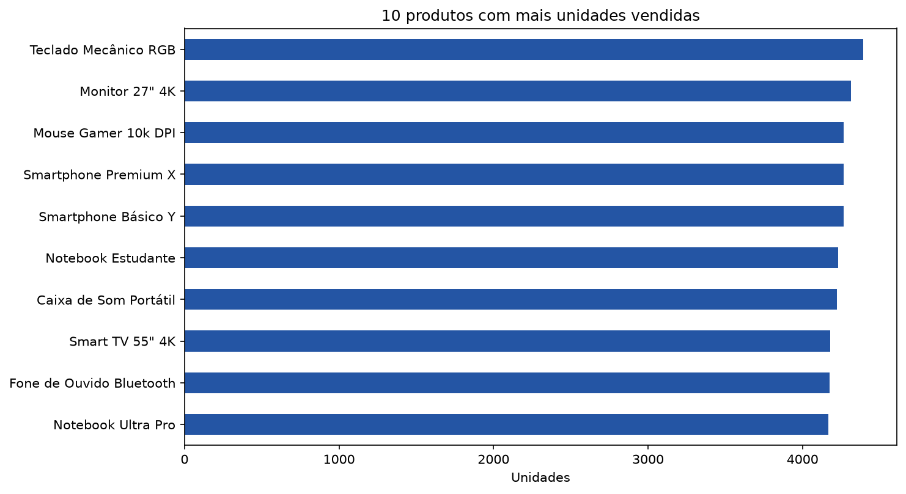
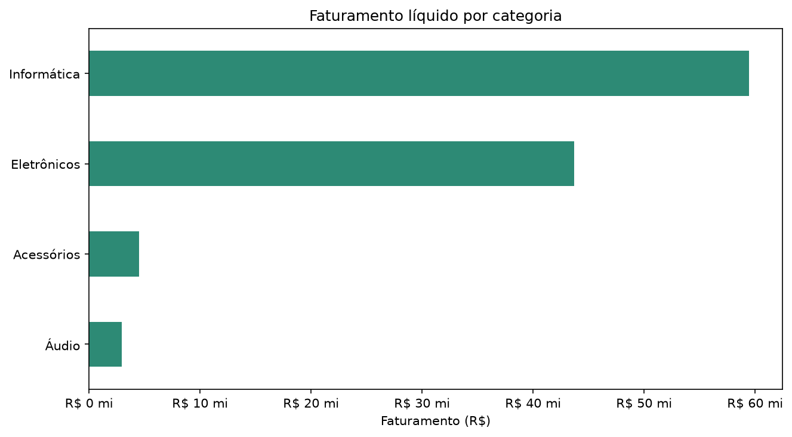
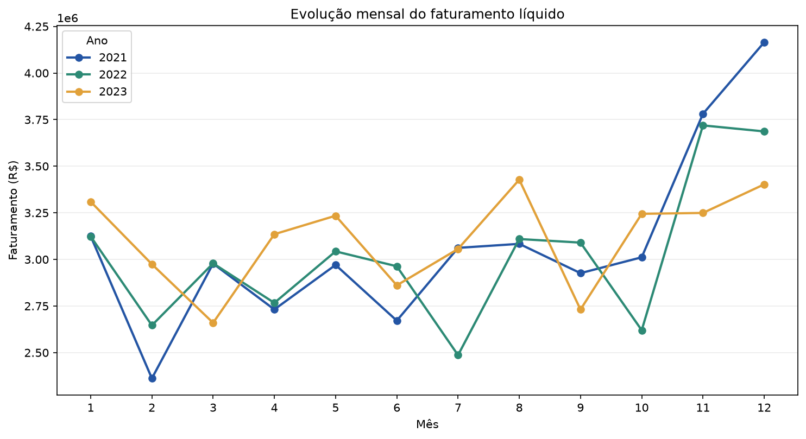
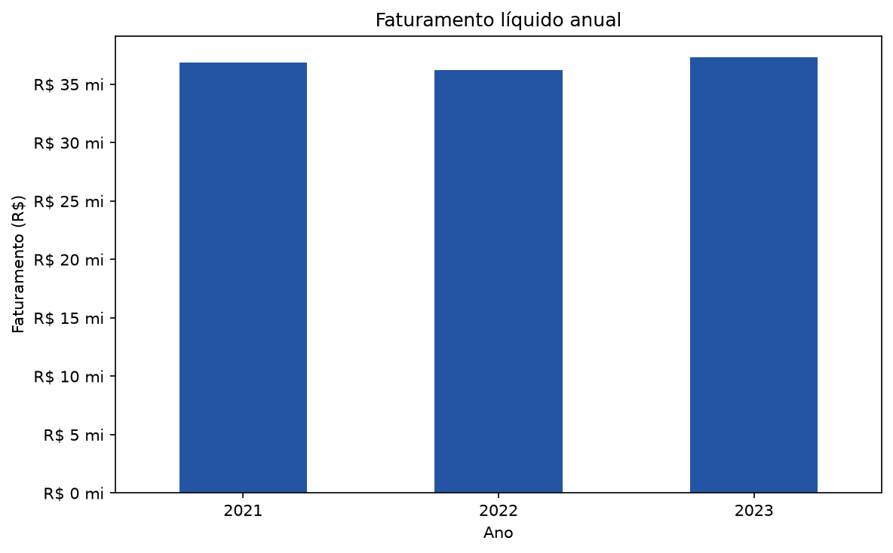
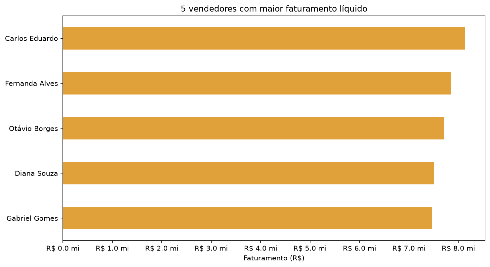
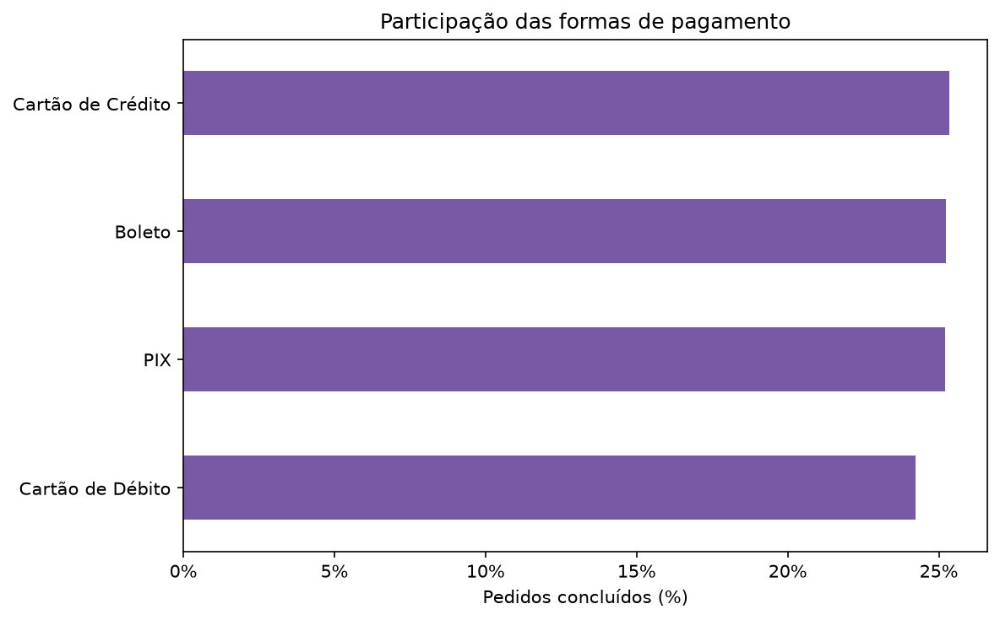
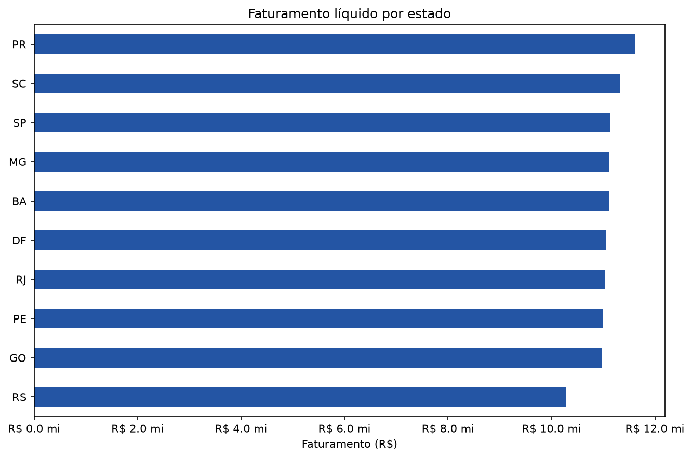
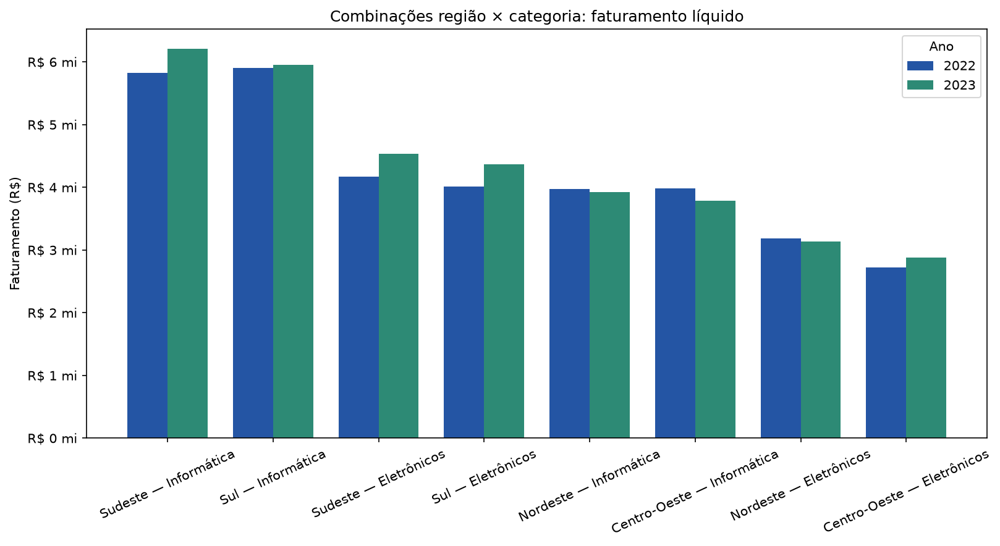

# Relatório — Sistema de Análise de Vendas

## Escopo e critérios

A base original contém **50.000 registros e 15 colunas**. Após remover 150 linhas integralmente duplicadas, 49.850 linhas únicas foram verificadas.
As métricas financeiras consideram apenas itens com quantidade positiva, preço válido e desconto entre zero e o valor bruto do item. Foram excluídas 149 linhas com inconsistências financeiras. 149 datas inválidas foram mantidas nos totais não temporais (os campos financeiros estavam utilizáveis), mas excluídas das séries temporais.
Faturamento bruto é preço unitário × quantidade; faturamento líquido é o bruto menos desconto. Ambos são calculados somente para vendas **Concluídas**. Cancelados, devolvidos e pendentes não entram em receita reconhecida. A base é de itens: pedidos foram contados por identificador único quando a pergunta pede transações.

## 1. Exploração inicial

- Registros e colunas: **50.000 × 15**.
- Os tipos originais das variáveis estão listados na tabela de qualidade abaixo; as datas foram convertidas para datetime e valores numéricos tratados como números.
- A base está no formato CSV separado por ponto e vírgula e codificado em UTF-8.

## 2. Qualidade e tratamento dos dados

| Verificação | Resultado | Decisão |
|---|---:|---|
| Linhas exatamente duplicadas | 150 | Removidas, mantendo a primeira ocorrência. |
| Datas inválidas | 149 | Excluídas somente de análises temporais; as demais colunas válidas permanecem nas métricas não temporais. |
| Quantidades nulas ou não positivas | 62 | Excluídas das métricas financeiras e de volume. |
| Descontos inválidos (negativos ou acima do bruto) | 149 | Excluídos das métricas financeiras; valores não foram corrigidos por estimativa. |
| Linhas financeiras excluídas (união das regras acima) | 149 | As regras sobre quantidade, desconto e preço se sobrepõem; contagem representa linhas únicas. |
| Cidade ausente na origem | 150 | Mantida como “Não informado”; a análise por UF continua possível. |
| Variações de grafia de categoria | Informática/Informatica e Eletrônicos/Eletronicos | Padronizadas sem acento inconsistente, preservando rótulos legíveis. |
| Total informado divergente do bruto menos desconto | 62 | O valor líquido é recalculado pelas colunas unitárias; os registros divergentes também são excluídos pela quantidade inválida. |
| Valores ausentes | 150 cidades; 0 nas demais colunas | Cidades ficam como “Não informado”; nenhuma outra coluna exigiu imputação. |

### Tipos de dados recebidos

| Coluna | Tipo pandas original |
|---|---|
| `id_item_venda` | `int64` |
| `id_pedido` | `int64` |
| `data_venda` | `str` |
| `nome_produto` | `str` |
| `categoria_produto` | `str` |
| `quantidade` | `int64` |
| `preco_unitario` | `float64` |
| `desconto` | `float64` |
| `valor_total` | `float64` |
| `nome_cliente` | `str` |
| `cidade_cliente` | `str` |
| `estado_cliente` | `str` |
| `nome_vendedor` | `str` |
| `forma_pagamento` | `str` |
| `status_venda` | `str` |

## 3. Faturamento total

- **Faturamento bruto concluído:** R$ 117.459.494,40.
- **Descontos nas vendas concluídas:** R$ 6.822.809,64.
- **Faturamento líquido concluído:** R$ 110.636.684,76.
- Base: 42.304 itens válidos de 24.305 pedidos concluídos.

## 4. Dez produtos mais vendidos

A classificação usa a soma da quantidade de unidades, não o número de pedidos.

| Produto | Unidades |
|---|---:|
| Teclado Mecânico RGB | 4.391 |
| Monitor 27" 4K | 4.314 |
| Mouse Gamer 10k DPI | 4.268 |
| Smartphone Premium X | 4.267 |
| Smartphone Básico Y | 4.265 |
| Notebook Estudante | 4.229 |
| Caixa de Som Portátil | 4.224 |
| Smart TV 55" 4K | 4.181 |
| Fone de Ouvido Bluetooth | 4.176 |
| Notebook Ultra Pro | 4.169 |

O gráfico destaca volume físico: um item pode liderar em unidades sem liderar em faturamento.

## 5. Desempenho por categoria

| Categoria | Faturamento líquido | Participação |
|---|---:|---:|
| Informática | R$ 59.464.270,43 | 53,75% |
| Eletrônicos | R$ 43.716.188,67 | 39,51% |
| Acessórios | R$ 4.492.688,29 | 4,06% |
| Áudio | R$ 2.963.537,37 | 2,68% |

Informática lidera, com R$ 59.464.270,43, R$ 15.748.081,76 acima de Eletrônicos.

## 6. Sazonalidade e evolução

| Ano | Faturamento líquido |
|---:|---:|
| 2021 | R$ 36.866.424,30 |
| 2022 | R$ 36.233.731,49 |
| 2023 | R$ 37.285.908,26 |

O mês de maior faturamento foi **12/2021** (R$ 4.164.758,49); o menor foi **02/2021** (R$ 2.361.780,41). Os 149 registros com data inválida não participam desta comparação.

A série permite comparar o mesmo mês entre anos e evidencia a oscilação sazonal; picos e vales mensais não devem ser confundidos com a tendência anual.

O faturamento caiu levemente de 2021 para 2022 e voltou a crescer em 2023, que foi o maior total anual da série.

## 7. Avaliação da equipe

Ticket médio = faturamento líquido do vendedor ÷ quantidade de pedidos concluídos únicos.

| Vendedor | Faturamento líquido | Pedidos | Ticket médio |
|---|---:|---:|---:|
| Carlos Eduardo | R$ 8.132.988,27 | 1.674 | R$ 4.858,42 |
| Fernanda Alves | R$ 7.855.462,08 | 1.683 | R$ 4.667,54 |
| Otávio Borges | R$ 7.705.379,77 | 1.607 | R$ 4.794,88 |
| Diana Souza | R$ 7.503.747,15 | 1.610 | R$ 4.660,71 |
| Gabriel Gomes | R$ 7.460.999,19 | 1.650 | R$ 4.521,82 |

## 8. Preferências de pagamento

Participação calculada pelo número de pedidos concluídos únicos, não por linhas de itens.

| Forma de pagamento | Pedidos | Participação |
|---|---:|---:|
| Cartão de Crédito | 6.158 | 25,34% |
| Boleto | 6.134 | 25,24% |
| PIX | 6.124 | 25,20% |
| Cartão de Débito | 5.889 | 24,23% |

As participações são próximas entre si; nenhuma forma concentra a maioria das transações.

## 9. Análise geográfica

| UF | Região | Faturamento líquido |
|---|---|---:|
| PR | Sul | R$ 11.614.642,97 |
| SC | Sul | R$ 11.328.216,07 |
| SP | Sudeste | R$ 11.136.545,89 |
| MG | Sudeste | R$ 11.113.253,06 |
| BA | Nordeste | R$ 11.112.591,29 |
| DF | Centro-Oeste | R$ 11.049.159,98 |
| RJ | Sudeste | R$ 11.038.777,38 |
| PE | Nordeste | R$ 10.987.283,83 |
| GO | Centro-Oeste | R$ 10.968.952,25 |
| RS | Sul | R$ 10.287.262,04 |

**PR** é a UF com maior faturamento líquido (R$ 11.614.642,97); a região com maior resultado agregado é **Sudeste** (R$ 33.288.576,33). As UFs ausentes não foram imputadas.

## 10. Visualizações

Os oito gráficos deste relatório cobrem produtos, categorias, evolução mensal e anual, vendedores, pagamentos, estados e o cruzamento estratégico da questão 11. Cada visualização acompanha a interpretação na seção correspondente.

## 11. Estudo aplicado — alocação de marketing e força de vendas

**Pergunta de negócio.** Em qual combinação de região e categoria a empresa deve testar a maior parcela incremental do orçamento no próximo trimestre?

**Metodologia.** Cruzamos região geográfica (UF agrupada nas cinco macrorregiões brasileiras), categoria e ano. Comparamos o faturamento líquido concluído de 2023 com 2022 para cada combinação. Para evitar recomendar uma queda recente, priorizamos a combinação com maior faturamento em 2023 entre aquelas com crescimento positivo ano contra ano. A leitura temporal usa apenas registros com data válida.

| Região | Categoria | 2022 | 2023 | Variação 2023/2022 |
|---|---|---:|---:|---:|
| Sudeste | Informática | R$ 5.828.404,18 | R$ 6.209.304,80 | 6,54% |
| Sul | Informática | R$ 5.901.932,65 | R$ 5.951.229,55 | 0,84% |
| Sudeste | Eletrônicos | R$ 4.167.610,15 | R$ 4.537.806,92 | 8,88% |
| Sul | Eletrônicos | R$ 4.007.845,46 | R$ 4.369.718,43 | 9,03% |
| Centro-Oeste | Eletrônicos | R$ 2.722.755,87 | R$ 2.881.344,77 | 5,82% |
| Sudeste | Acessórios | R$ 435.966,73 | R$ 500.289,68 | 14,75% |
| Sul | Acessórios | R$ 421.483,74 | R$ 423.794,41 | 0,55% |
| Sul | Áudio | R$ 290.468,28 | R$ 308.960,19 | 6,37% |

**Conclusão executiva.** Recomendamos direcionar o maior teste incremental — não todo o orçamento — para **Informática na região Sudeste**. A combinação gerou R$ 6.209.304,80 em 2023, ante R$ 5.828.404,18 em 2022 (6,54%). A recomendação combina escala atual e crescimento positivo; deve ser validada com um teste controlado e acompanhamento de conversão e margem, que não estão disponíveis nesta base. Isso evita interpretar faturamento como lucro.

## Apêndice — observações de qualidade

- Registros com data válida e incluídos nas tendências: 42.178 itens concluídos após o tratamento financeiro.
- Datas ausentes na origem: 0; datas não interpretáveis: 149.
- Categorias e formas de pagamento foram normalizadas ignorando diferenças de acentuação e espaços; demais valores não foram inferidos.
