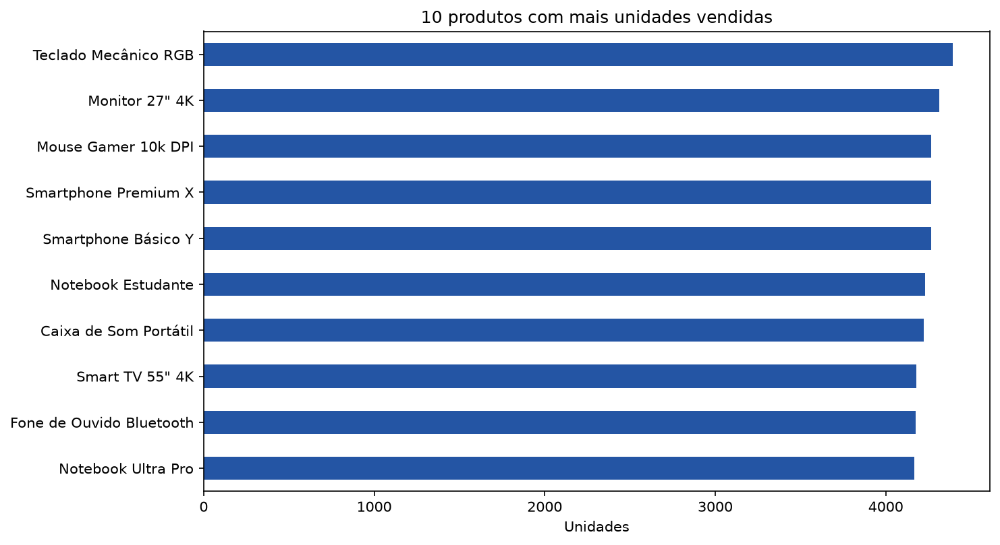
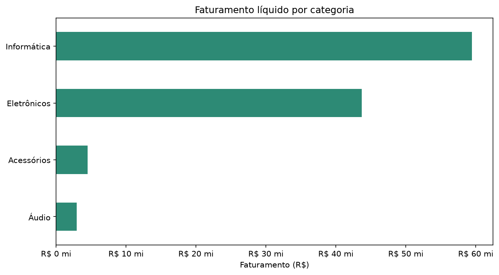
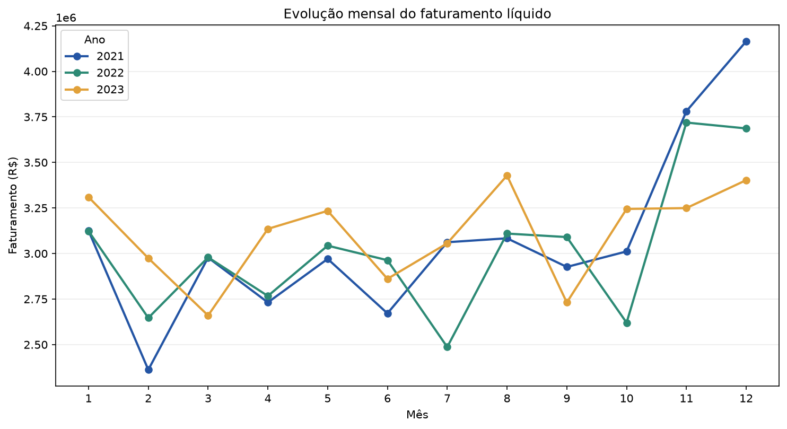
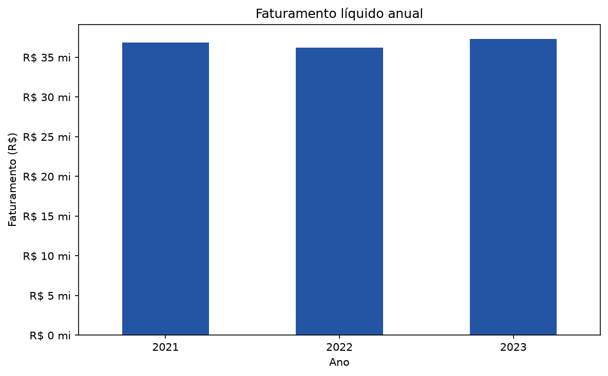
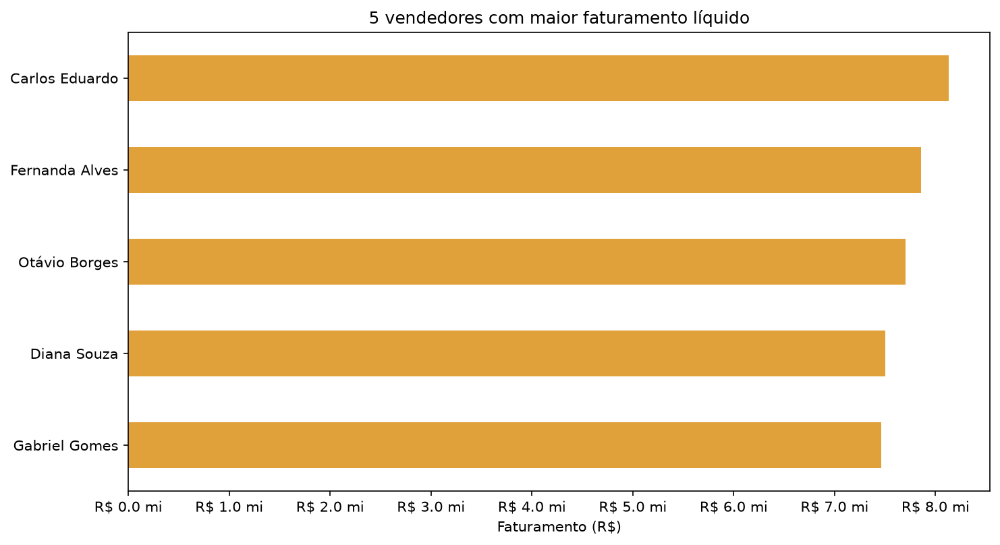
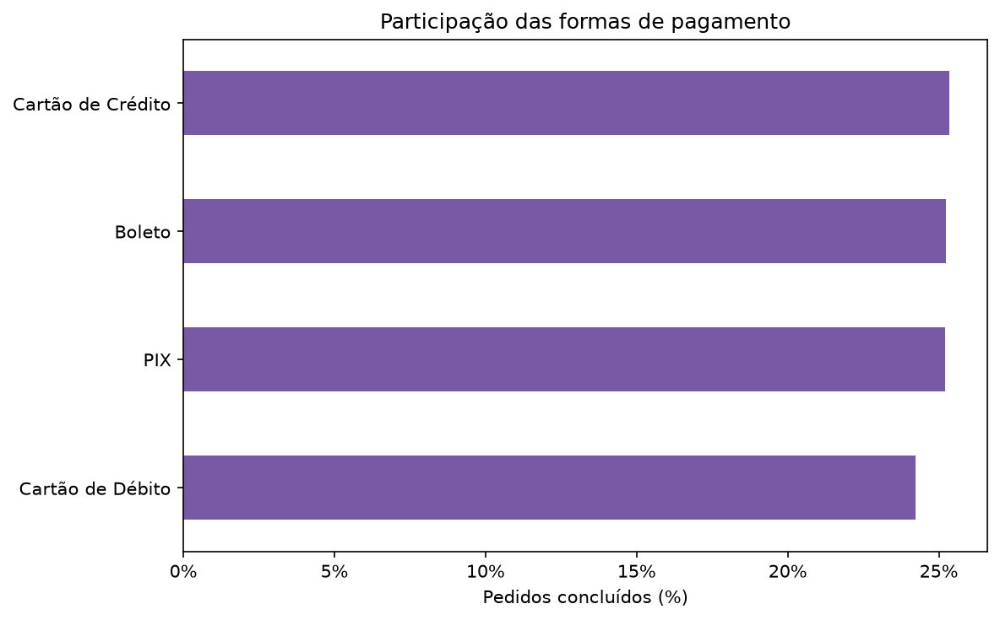
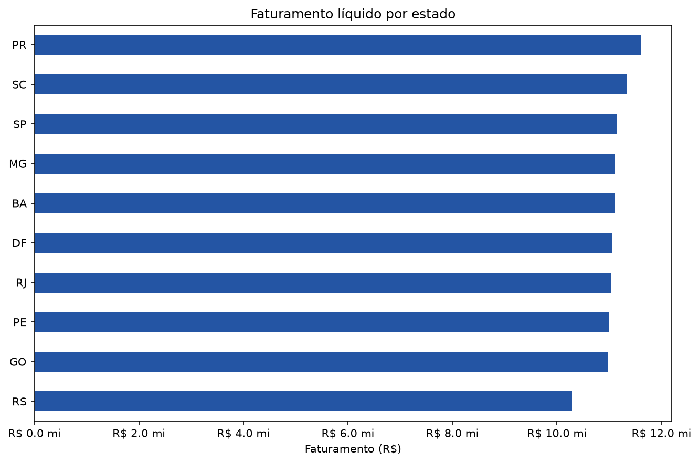
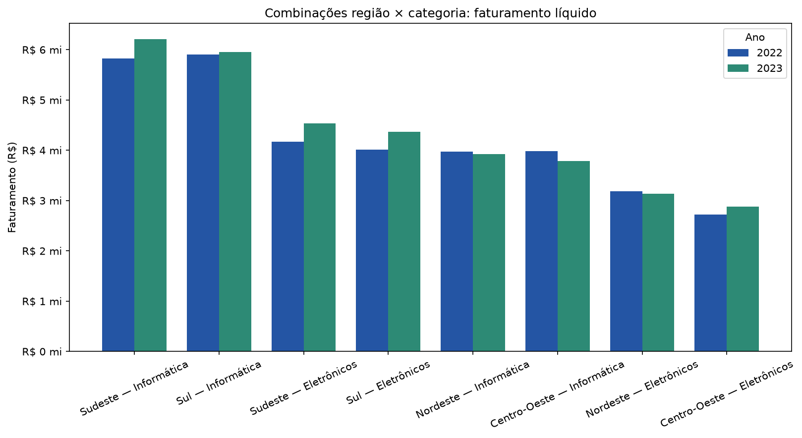

# Projeto Prático — Sistema de Análise de Vendas

Análise em Python da base de vendas de 2021 a 2023, conforme as questões do projeto prático. O script realiza a exploração, limpeza, cálculo dos indicadores, criação de oito gráficos e geração de um relatório Markdown com interpretações e recomendação executiva.

## Arquivos

- `analise_vendas.py`: pipeline de análise, ETL e geração de resultados.
- `Projeto Final Python/vendas.csv`: base de dados original, com separador `;` e codificação UTF-8.
- `resultado/relatorio_analise_vendas.md`: respostas às questões, decisões de limpeza e conclusões.
- `resultado/relatorio_analise_vendas.pdf`: versão paginada do relatório, com tabelas e gráficos incorporados.
- `resultado/graficos`: visualizações referenciadas pelo relatório.

## Como executar

Requer Python 3.10 ou superior, Pandas e Matplotlib:

```bash
python -m pip install pandas matplotlib
python analise_vendas.py
```

O relatório em Markdown, o PDF e os gráficos são gravados em `resultado`. Para escolher outros caminhos:

```bash
python analise_vendas.py --csv caminho/para/vendas.csv --output-dir pasta/de/saida
```

## Gráficos gerados

O script cria oito gráficos PNG na pasta `resultado/graficos`. Eles também são incorporados ao relatório Markdown e ao PDF. Cada gráfico responde a uma parte da análise:

1. **Produtos mais vendidos:** compara os dez produtos com maior quantidade total de unidades vendidas.

   

2. **Faturamento por categoria:** compara o faturamento líquido e a participação de cada categoria no total.

   

3. **Evolução mensal:** mostra a variação do faturamento líquido mês a mês, com uma série para cada ano, permitindo observar sazonalidades e comparar períodos equivalentes.

   

4. **Faturamento anual:** compara os totais líquidos de cada ano e evidencia a evolução entre 2021 e 2023.

   

5. **Desempenho dos vendedores:** compara o faturamento líquido dos cinco vendedores com melhor resultado. A tabela do relatório também apresenta pedidos e ticket médio.

   

6. **Formas de pagamento:** apresenta a participação percentual de cada método entre os pedidos concluídos, contando cada pedido uma única vez.

   

7. **Faturamento por estado:** compara o faturamento líquido entre as UFs presentes na base e ajuda a identificar os estados com maior resultado comercial.

   

8. **Cruzamento estratégico — região e categoria:** compara o faturamento das principais combinações de macrorregião e categoria em 2022 e 2023. Essa visualização sustenta a recomendação da questão 11.

   

## Critérios analíticos

- A base é granular por item vendido. Quantidade de pedidos é calculada por `id_pedido` único, evitando contar cada item como transação.
- Faturamento bruto usa `preco_unitario × quantidade`; faturamento líquido subtrai `desconto`. Para ambos, só vendas concluídas são consideradas receita reconhecida.
- Linhas exatamente duplicadas são removidas. Quantidades não positivas e descontos negativos ou superiores ao valor bruto são excluídos dos indicadores financeiros, sem correções especulativas.
- Categorias com diferenças de acentuação são padronizadas. Cidades ausentes são identificadas como “Não informado”.
- Datas inválidas não são usadas nas análises temporais, mas os campos financeiros válidos desses registros permanecem nos totais não temporais. O relatório explicita essa limitação.
- A análise estratégica compara o faturamento líquido de 2022 e 2023 por macrorregião e categoria. A recomendação é uma hipótese de teste, não uma afirmação de lucratividade: a base não contém custos, margem ou conversões de campanhas.
- O script contém comentários em português explicando as instruções, etapas de limpeza, cálculos, gráficos e geração do relatório.
